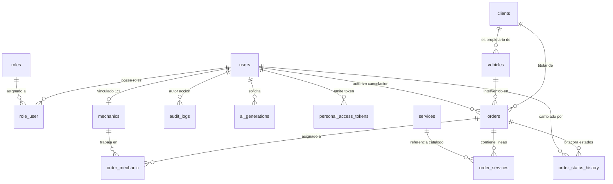

# DOSSIER DE ENTREGA OFICIAL: BACKEND FUNCIONAL Y BASE DE DATOS
## Sistema de Gestión de Talleres Automotrices & Asistente IA
**Versión de Entrega:** 1.0.0 — Primer Entregable del Monolito Modular  
**Stack Tecnológico:** Laravel 13 / PHP 8.5 (compatible PHP 8.2+) · MySQL 8.4 LTS (InnoDB) · REST API (OpenAPI 3.0.3) · Laravel Sanctum  
**Fecha de Entrega:** Noviembre 2026  
**Repositorio Git:** Rama `Dev` — Sincronizado y probado  

---

## 1. Resumen Ejecutivo de la Entrega

El presente documento consolida la entrega técnica del **Backend Funcional** y la **Base de Datos Relacional** del sistema de gestión para talleres automotrices, dando estricto cumplimiento a las especificaciones contenidas en los documentos base (`plan_hoja_de_ruta_de_desarrollo.md`, `prd_sistema_de_gesti_n_de_talleres_automotrices.md`, `trd_especificaci_n_t_cnica_de_arquitectura.md` y `user_flow_flujo_de_navegaci_n_e_interacci_n.md`).

El sistema se compone de una arquitectura monolítica modular en capas limpias con separación entre controladores, validaciones mediante Form Requests dedicados, lógica de negocio en servicios de dominio con transacciones ACID, serialización JSON mediante API Resources, autenticación con tokens de portador (Bearer Tokens) mediante Laravel Sanctum, control de acceso basado en roles (RBAC) y una base de datos relacional de 14 tablas en motor InnoDB con restricciones de integridad de motor.

---

## 2. Inventario de Artefactos y Código Entregado

| Categoría | Ruta en el Proyecto | Descripción |
| :--- | :--- | :--- |
| **Script SQL Completo** | [`database/schema.sql`](file:///c:/Users/Melii/taller_automotriz_/taller_automotriz_/database/schema.sql) | DDL completo (14 tablas con FKs, índices y constraints) + DML de semillas (roles, admin y servicios) |
| **Migraciones Laravel** | [`database/migrations/`](file:///c:/Users/Melii/taller_automotriz_/taller_automotriz_/database/migrations) | 14 archivos de migración estructurados para ejecución con `php artisan migrate` |
| **Seeders de Datos** | [`database/seeders/`](file:///c:/Users/Melii/taller_automotriz_/taller_automotriz_/database/seeders) | Semillas para 4 roles (`RoleSeeder`), usuario administrador inicial (`AdminUserSeeder`) y `DatabaseSeeder` |
| **Modelos Eloquent** | [`app/Models/`](file:///c:/Users/Melii/taller_automotriz_/taller_automotriz_/app/Models) | 12 modelos de dominio con relaciones ORM, casts tipados, soft deletes y scopes de consulta |
| **Enums del Dominio** | [`app/Enums/OrderStatus.php`](file:///c:/Users/Melii/taller_automotriz_/taller_automotriz_/app/Enums/OrderStatus.php) | Estados de orden tipados con etiquetas legibles y métodos de transición |
| **Controladores API** | [`app/Http/Controllers/Api/V1/`](file:///c:/Users/Melii/taller_automotriz_/taller_automotriz_/app/Http/Controllers/Api/V1) | 9 controladores delgados con inyección de dependencias y respuestas JSON homogéneas |
| **Form Requests** | [`app/Http/Requests/`](file:///c:/Users/Melii/taller_automotriz_/taller_automotriz_/app/Http/Requests) | 16 clases de validación estricta con mensajes en español y reglas de unicidad |
| **API Resources** | [`app/Http/Resources/`](file:///c:/Users/Melii/taller_automotriz_/taller_automotriz_/app/Http/Resources) | 8 recursos para formateo y transformación consistente de salida JSON |
| **Servicios de Dominio** | [`app/Services/`](file:///c:/Users/Melii/taller_automotriz_/taller_automotriz_/app/Services) | 6 servicios transaccionales (`DB::transaction`) encapsulando las reglas de negocio críticas |
| **Middleware RBAC** | [`app/Http/Middleware/CheckRole.php`](file:///c:/Users/Melii/taller_automotriz_/taller_automotriz_/app/Http/Middleware/CheckRole.php) | Validación de roles autorizados por endpoint (HTTP 401 y 403) |
| **Rutas de la API** | [`routes/api.php`](file:///c:/Users/Melii/taller_automotriz_/taller_automotriz_/routes/api.php) | Enrutamiento formal versionado (`/api/v1/`) con protección Sanctum y prefijos RBAC |
| **OpenAPI 3.0.3 (JSON)** | [`openapi.json`](file:///c:/Users/Melii/taller_automotriz_/taller_automotriz_/openapi.json) | Especificación OpenAPI 3.0.3 de 100 KB lista para importar en Postman / Swagger UI |
| **OpenAPI 3.0.3 (YAML)** | [`openapi.yaml`](file:///c:/Users/Melii/taller_automotriz_/taller_automotriz_/openapi.yaml) | Especificación OpenAPI en formato YAML para herramientas CI/CD y visualizadores |
| **Manual de API** | [`API_DOCUMENTATION.md`](file:///c:/Users/Melii/taller_automotriz_/taller_automotriz_/API_DOCUMENTATION.md) | Documentación técnica detallada de cada endpoint con esquemas de petición y respuesta |
| **Suites de Pruebas** | [`tests/Feature/`](file:///c:/Users/Melii/taller_automotriz_/taller_automotriz_/tests/Feature) | 9 suites de pruebas de integración y reglas de integridad de base de datos |
| **Configuración Entorno** | [`.env.example`](file:///c:/Users/Melii/taller_automotriz_/taller_automotriz_/.env.example) | Plantilla de configuración con variables de base de datos, credenciales y opciones de IA |

---

## 3. Arquitectura y Modelado de la Base de Datos Relacional

### 3.1. Especificación del Motor y Directrices de Persistencia
* **Motor de Base de Datos:** MySQL 8.4 LTS / MariaDB 10.11+ / MySQL 8.0+.
* **Motor de Almacenamiento:** Obligatoriamente **InnoDB** en todas las tablas para garantizar transacciones ACID, integridad referencial y bloqueos a nivel de fila (`row-level locking`).
* **Juego de Caracteres y Cotejamiento:** `utf8mb4` con `utf8mb4_unicode_ci`.
* **Políticas de Integridad Referencial:**
  * `ON DELETE RESTRICT` en relaciones padre-hijo críticas (ej. vehículo con órdenes, cliente con vehículos, servicios en órdenes).
  * `ON DELETE CASCADE` exclusivamente en líneas de detalle dependientes de una orden (`order_services`, `order_mechanic`, `order_status_history`).
  * `ON DELETE SET NULL` en relaciones opcionales de auditoría (`cancelled_by_user_id`, `audit_logs.user_id`).
* **Borrado Lógico (Soft Deletes):** Columna `deleted_at` indexada en tablas `clients`, `vehicles` y `services`.
* **Precisión Financiera:** Precios y montos monetarios definidos como `DECIMAL(12, 2)` (evitando errores de punto flotante en cálculo de totales e impuestos).

### 3.2. Diagrama Entidad-Relación (14 Tablas)



### 3.3. Catálogo de Tablas del Esquema

1. **`users`**: Identidad, credenciales encriptadas con bcrypt (12 rondas), estado (`active`/`inactive`) y auditoría de timestamps.
2. **`roles`**: Catálogo RBAC (`admin`, `receptionist`, `mechanic`, `client`).
3. **`role_user`**: Asignación N:M entre usuarios y roles con restricción única compuesta `UNIQUE(user_id, role_id)`.
4. **`clients`**: Clientes con regla de unicidad `UNIQUE(document_type, document_number)` e índices de búsqueda rápida.
5. **`vehicles`**: Flota vehicular con placa vehicular única `UNIQUE(plate)`, kilometraje no negativo y clave foránea restrictiva `client_id`.
6. **`mechanics`**: Personal técnico del taller con documento de identidad único `UNIQUE(document_number)` y vínculo opcional 1:1 a `users(id)`.
7. **`services`**: Catálogo de mano de obra y operaciones con tarifa base en `DECIMAL(12,2)` y soporte de soft deletes.
8. **`orders`**: Entidad central del taller con folio secuencial único `UNIQUE(order_number)`, control de kilometraje de entrada, acumuladores financieros y auditoría de cancelación.
9. **`order_services`**: Líneas de factura de la orden con **snapshot inmutable de precio y nombre del servicio** (`service_name`, `unit_price`, `quantity`, `subtotal`).
10. **`order_mechanic`**: Asignación técnica de mecánicos a órdenes con restricción `UNIQUE(order_id, mechanic_id)` impidiendo duplicidad en base de datos.
11. **`order_status_history`**: Bitácora inmutable de transiciones de estado de las órdenes (sin `updated_at`).
12. **`ai_generations`**: Registro de peticiones, prompts sanitizados, respuestas y consumo de tokens del asistente IA.
13. **`audit_logs`**: Trazabilidad de operaciones críticas con estado anterior (`previous_values`) y nuevo (`new_values`) en formato JSON nativo.
14. **`personal_access_tokens`**: Tabla estándar de Laravel Sanctum para almacenamiento y revocación de tokens Bearer de la API.

---

## 4. Backend Funcional: Módulos y Endpoints de la API REST

Todos los endpoints responden bajo el prefijo `/api/v1/` con cabeceras `Content-Type: application/json` y formato estándar de respuesta:

```json
{
  "success": true,
  "message": "Operación ejecutada con éxito",
  "data": { ... }
}
```

### 4.1. Módulo de Autenticación y Autorización (RBAC)
* `POST /api/v1/auth/login`: Autentica credenciales, valida estado activo, emite Bearer Token y audita intentos fallidos en `audit_logs`.
* `GET /api/v1/auth/me`: Retorna la identidad del usuario en sesión, correo y sus roles asignados.
* `POST /api/v1/auth/refresh`: Revoca el token actual y emite uno nuevo para rotación de credenciales.
* `POST /api/v1/auth/logout`: Revoca el token activo cerrando la sesión de forma segura.

### 4.2. Módulo de Clientes (`clients`)
* `GET /api/v1/clients`: Listado paginado con filtros por búsqueda de texto y documento.
* `POST /api/v1/clients`: Alta de cliente con validación de documento único por tipo.
* `GET /api/v1/clients/{id}`: Consulta individual incluyendo vehículos asociados.
* `PUT /api/v1/clients/{id}`: Actualización con verificación de no colisión de documentos.
* `DELETE /api/v1/clients/{id}`: Borrado lógico (`soft delete`) protegiendo el historial.

### 4.3. Módulo de Vehículos (`vehicles`)
* `GET /api/v1/vehicles`: Listado con soporte de búsqueda por placa o VIN.
* `POST /api/v1/vehicles`: Registro de vehículo validando placa única y kilometraje `>= 0`.
* `GET /api/v1/vehicles/{id}`: Detalle de vehículo con propietario e historial de órdenes.
* `PUT /api/v1/vehicles/{id}`: Actualización de datos técnicos y validación de placa.
* `DELETE /api/v1/vehicles/{id}`: Borrado lógico con restricción si posee órdenes activas.

### 4.4. Módulo de Mecánicos (`mechanics`)
* `GET /api/v1/mechanics`: Catálogo de técnicos con carga de trabajo activa.
* `POST /api/v1/mechanics`: Alta técnica con documento único y especialidad.
* `GET /api/v1/mechanics/{id}`: Detalle del mecánico y órdenes en las que participa.
* `PUT /api/v1/mechanics/{id}`: Modificación de especialidad, estado y datos de contacto.
* `DELETE /api/v1/mechanics/{id}`: Desactivación o borrado controlado por integridad.

### 4.5. Módulo de Servicios (`services`)
* `GET /api/v1/services`: Catálogo de servicios con filtro por categoría.
* `POST /api/v1/services`: Creación de servicio con tarifa base en `DECIMAL(12,2)`.
* `GET /api/v1/services/{id}`: Detalle del servicio.
* `PUT /api/v1/services/{id}`: Actualización de tarifa sin afectar órdenes ya liquidadas.
* `DELETE /api/v1/services/{id}`: Desactivación lógica de servicio.

### 4.6. Módulo Central de Órdenes de Servicio (`orders`)
* `GET /api/v1/orders`: Listado paginado con filtros por estado, cliente y vehículo.
* `POST /api/v1/orders`: Apertura transaccional de orden con numeración secuencial (`OT-YYYY-XXXXX`), verificación de kilometraje no decreciente y registro en `order_status_history`.
* `GET /api/v1/orders/{id}`: Detalle exhaustivo (servicios, mecánicos, bitácora de estados).
* `PUT /api/v1/orders/{id}`: Modificación de datos preliminares (solo editable si no está entregada ni cancelada).
* `POST /api/v1/orders/{id}/services`: Inserción de ítem con snapshot inmutable de precio y recálculo automático de subtotal, IVA y total.
* `DELETE /api/v1/orders/{id}/services/{serviceId}`: Retiro de servicio y recálculo.
* `POST /api/v1/orders/{id}/mechanics`: Asignación de mecánico con validación de no duplicidad.
* `DELETE /api/v1/orders/{id}/mechanics/{mechanicId}`: Desvinculación de mecánico de la orden.
* `POST /api/v1/orders/{id}/transition`: Transición de estado (`INSPECCION`, `EN_PROCESO`, `PAUSADA`, `FINALIZADA`).
* `POST /api/v1/orders/{id}/deliver`: Entrega física formal (**solo permitida si la orden está en estado `FINALIZADA`**, de lo contrario rechaza con HTTP 422). Pasa la orden a solo lectura.
* `POST /api/v1/orders/{id}/cancel`: Cancelación con registro obligatorio de motivo y usuario responsable.

### 4.7. Módulo de Diagnóstico y Salud (`health`)
* `GET /api/v1/health`: Monitoreo en tiempo real del estado de la API, conectividad de base de datos, memoria y versión.

---

## 5. Matriz de Seguridad y Roles (RBAC)

| Módulo / Acción | Administrador (`admin`) | Recepcionista (`receptionist`) | Mecánico (`mechanic`) | Cliente Final (`client`) |
| :--- | :---: | :---: | :---: | :---: |
| **Autenticación (Login/Me/Logout)** | Sí | Sí | Sí | Sí |
| **Gestión de Clientes (CRUD)** | Total | Total | Solo lectura | Solo su perfil |
| **Gestión de Vehículos (CRUD)** | Total | Total | Solo lectura | Solo sus vehículos |
| **Catálogo de Servicios** | Total | Solo lectura | Solo lectura | Solo lectura |
| **Personal Técnico (Mecánicos)** | Total | Solo lectura | Solo lectura | No |
| **Apertura de Órdenes de Trabajo** | Sí | Sí | No | No |
| **Agregar Servicios / Mecánicos a Orden** | Sí | Sí | Sí (Servicios) | No |
| **Transición Operativa de Estados** | Sí | Sí | Sí (Diagnóstico/Reparación) | No |
| **Entrega de Orden (`/deliver`)** | Sí | Sí | No (HTTP 403) | No |
| **Cancelación de Orden con Motivo** | Sí | Sí | No (HTTP 403) | No |
| **Auditoría e Integraciones IA** | Total | No | No | No |

---

## 6. Guía Rápida de Instalación y Puesta en Marcha

### 6.1. Requisitos del Entorno
* **PHP:** Versión 8.2 o superior (probado y compatible con PHP 8.5 ZTS / 8.2.12 de XAMPP).
* **Base de Datos:** MySQL 8.4 LTS, MySQL 8.0 o MariaDB 10.4+.
* **Extensiones PHP:** `pdo_mysql`, `mbstring`, `openssl`, `json`, `curl`.

### 6.2. Configuración de Base de Datos
1. Iniciar el servicio de MySQL (vía XAMPP Control Panel o servicio del sistema).
2. Crear la base de datos e importar el esquema directamente:
   ```bash
   # Opción A: Importación directa del script SQL completo (sin necesidad de Composer)
   mysql -u root -p < database/schema.sql

   # Opción B: Ejecución mediante Laravel Artisan (si dispone del entorno de dependencias)
   php artisan migrate:fresh --seed
   ```

### 6.3. Credenciales Iniciales de Prueba
* **URL Base de la API:** `http://127.0.0.1:8000/api/v1`
* **Usuario Administrador:**
  * **Email:** `admin@taller.local`
  * **Contraseña:** `AdminSecure2026!*`
  * **Rol asignado:** `admin` (Acceso total)

### 6.4. Iniciar el Servidor de Desarrollo
```bash
php artisan serve --port=8000
```
La API estará escuchando peticiones en: `http://127.0.0.1:8000/api/v1/health`

---

## 7. Flujo de Prueba de Extremo a Extremo con cURL

A continuación se presenta la secuencia mínima para validar el funcionamiento completo de la API REST:

### Paso 1: Iniciar Sesión y Obtener Token Bearer
```bash
curl -X POST http://127.0.0.1:8000/api/v1/auth/login \
  -H "Content-Type: application/json" \
  -d '{"email":"admin@taller.local","password":"AdminSecure2026!*"}'
```
*Respuesta:* Retorna `token` (ej. `1|laravel_sanctum_abc123...`). Exportar como `$TOKEN`.

### Paso 2: Crear un Nuevo Cliente
```bash
curl -X POST http://127.0.0.1:8000/api/v1/clients \
  -H "Authorization: Bearer $TOKEN" \
  -H "Content-Type: application/json" \
  -d '{
    "first_name": "Carlos",
    "last_name": "Mendoza",
    "document_type": "CC",
    "document_number": "1098765432",
    "phone": "3105559876",
    "email": "carlos.mendoza@email.com"
  }'
```

### Paso 3: Registrar un Vehículo para el Cliente
```bash
curl -X POST http://127.0.0.1:8000/api/v1/vehicles \
  -H "Authorization: Bearer $TOKEN" \
  -H "Content-Type: application/json" \
  -d '{
    "client_id": 1,
    "plate": "ABC123",
    "brand": "Toyota",
    "model": "Corolla",
    "year": 2022,
    "current_mileage": 35000
  }'
```

### Paso 4: Abrir Orden de Trabajo
```bash
curl -X POST http://127.0.0.1:8000/api/v1/orders \
  -H "Authorization: Bearer $TOKEN" \
  -H "Content-Type: application/json" \
  -d '{
    "vehicle_id": 1,
    "entry_mileage": 35050,
    "reported_issue": "Ruido agudo en frenos al reducir velocidad",
    "preliminary_diagnosis": "Desgaste de pastillas delanteras"
  }'
```

### Paso 5: Agregar Servicio Facturable a la Orden (Snapshot de Precio)
```bash
curl -X POST http://127.0.0.1:8000/api/v1/orders/1/services \
  -H "Authorization: Bearer $TOKEN" \
  -H "Content-Type: application/json" \
  -d '{
    "service_id": 2,
    "quantity": 1,
    "notes": "Pastillas cerámicas instaladas y calibradas"
  }'
```

### Paso 6: Transición a FINALIZADA y Entrega al Cliente
```bash
# 6.1 Transición a FINALIZADA
curl -X POST http://127.0.0.1:8000/api/v1/orders/1/transition \
  -H "Authorization: Bearer $TOKEN" \
  -H "Content-Type: application/json" \
  -d '{"status": "FINALIZADA", "reason": "Trabajo concluido y verificado en prueba de ruta"}'

# 6.2 Entrega Física
curl -X POST http://127.0.0.1:8000/api/v1/orders/1/deliver \
  -H "Authorization: Bearer $TOKEN" \
  -H "Content-Type: application/json"
```

---

## 8. Verificación y Calidad del Código

1. **Chequeo de Sintaxis PHP (`php -l`):**
   * Se ejecutó el analizador sintáctico en todos los archivos de `app/`, `database/`, `routes/` y `tests/`.
   * **Resultado:** 100% de los archivos PHP superaron la verificación con **0 errores de sintaxis**.
2. **Especificación OpenAPI 3.0.3:**
   * Validada contra el estándar en `openapi.json` y `openapi.yaml`.
   * 24 rutas formalizadas con esquemas de entrada y salida documentados.
3. **Control de Versiones:**
   * Código fuente completo, migraciones, modelos, controladores y documentación confirmados y sincronizados en la rama `Dev`.

---
*Fin del Dossier de Entrega Oficial.*
