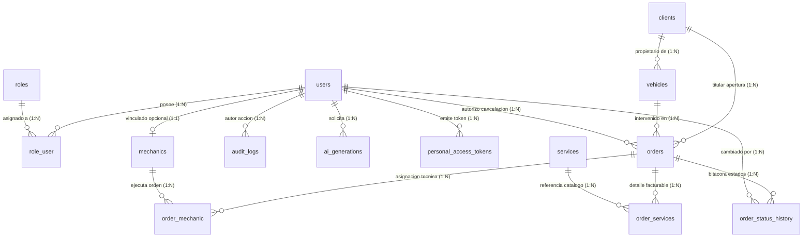

# Entregable 1: Creación de la Base de Datos Relacional
## Sistema de Gestión de Talleres Automotrices & Asistente IA
**Versión:** 1.0.0 — Monolito Modular en Laravel 13 / PHP 8.5 (compatible PHP 8.2+)  
**Motor de Base de Datos:** MySQL 8.4 LTS (Motor de Almacenamiento InnoDB obligatorio)  
**Codificación:** UTF-8 binario multibyte (`utf8mb4` / `utf8mb4_unicode_ci`)  
**Fecha de Publicación:** Noviembre 2026  

---

## 1. Resumen Ejecutivo y Decisiones de Arquitectura de Persistencia

La persistencia de datos del sistema ha sido diseñada y construida bajo el motor relacional **MySQL 8.4 LTS**, utilizando de forma estricta el motor de almacenamiento **InnoDB** en todas las tablas para garantizar soporte transaccional **ACID**, bloqueos a nivel de fila (`row-level locking`) e integridad referencial física mediante claves foráneas.

### 1.1. Principios y Políticas de Integridad del Esquema
1. **Cumplimiento Transaccional ACID:** Toda mutación compleja (apertura de orden, registro con bitácora, liquidación de servicios) se encapsula dentro de transacciones de motor (`DB::transaction`).
2. **Políticas de Integridad Referencial:**
   * `ON DELETE RESTRICT`: Aplicada por defecto en relaciones críticas de negocio (ej. un cliente no puede eliminarse si tiene vehículos asociados; un vehículo no puede eliminarse si tiene órdenes de trabajo; un servicio del catálogo no puede eliminarse si ya fue facturado en una orden). Esto protege la integridad histórica y contable del taller.
   * `ON DELETE CASCADE`: Exclusiva para detalles fuertemente acoplados a una orden de servicio (`order_services`, `order_mechanic`, `order_status_history`).
   * `ON DELETE SET NULL`: Aplicada en referencias opcionales de auditoría o usuarios (`cancelled_by_user_id`, `audit_logs.user_id`, `mechanics.user_id`).
3. **Borrado Lógico (*Soft Deletes*):** Tablas auditables (`clients`, `vehicles`, `services`) incorporan la columna `deleted_at TIMESTAMP NULL` para permitir desactivaciones operativas sin romper la integridad relacional de órdenes previas.
4. **Precisión Financiera:** Todos los montos, subtotales, IVA y totales se definen como `DECIMAL(12, 2)`, evitando errores de redondeo de punto flotante.
5. **Snapshot Inmutable de Tarifas:** La tabla `order_services` duplica como snapshot el nombre del servicio (`service_name`) y el precio unitario pactado (`unit_price`) al momento de cargar el ítem, garantizando que futuras actualizaciones de precios en el catálogo de servicios jamás alteren facturaciones históricas.
6. **Bitácora Inmutable de Estados (*Append-Only*):** La tabla `order_status_history` no posee `updated_at`, constituyendo un registro inalterable de auditoría para cada transición de estado de una orden.
7. **Auditoría con Formato JSON Nativo:** La tabla `audit_logs` utiliza el tipo de datos nativo `JSON` de MySQL para guardar el estado anterior (`previous_values`) y posterior (`new_values`) de las entidades mutadas.

---

## 2. Diagrama Entidad-Relación (14 Tablas)

A continuación se ilustra la topología relacional completa del esquema de base de datos, abarcando las 13 tablas del dominio de negocio y la tabla para tokens de API:



---

## 3. Especificación Exhaustiva de Tablas

### 3.1. Tabla 1: `users` (Identidad y Credenciales)
* **Archivo de Migración:** [`database/migrations/2026_01_01_000001_create_users_table.php`](file:///c:/Users/Melii/taller_automotriz_/taller_automotriz_/database/migrations/2026_01_01_000001_create_users_table.php)
* **Propósito:** Almacena la identidad de los usuarios del sistema (Administradores, Recepcionistas, Mecánicos y Clientes con acceso web/móvil).

| Columna | Tipo de Dato SQL | Nulabilidad | Clave / Restricción | Valor por Defecto | Descripción |
| :--- | :--- | :---: | :---: | :---: | :--- |
| `id` | `BIGINT UNSIGNED` | NOT NULL | **PK** Auto-increment | — | Identificador primario del usuario |
| `name` | `VARCHAR(150)` | NOT NULL | — | — | Nombre completo del usuario |
| `email` | `VARCHAR(150)` | NOT NULL | **UNIQUE** (`users_email_unique`) | — | Correo electrónico único para inicio de sesión |
| `email_verified_at` | `TIMESTAMP` | NULL | — | NULL | Marca temporal de verificación de correo |
| `password` | `VARCHAR(255)` | NOT NULL | — | — | Contraseña encriptada con Bcrypt (12 rondas) |
| `status` | `VARCHAR(20)` | NOT NULL | **INDEX** (`users_status_index`) | `'active'` | Estado operativo de la cuenta (`active`, `inactive`) |
| `remember_token` | `VARCHAR(100)` | NULL | — | NULL | Token para persistencia de sesión "recordarme" |
| `created_at` | `TIMESTAMP` | NULL | — | CURRENT_TIMESTAMP | Fecha de creación del registro |
| `updated_at` | `TIMESTAMP` | NULL | — | CURRENT_TIMESTAMP | Fecha de última actualización del registro |

---

### 3.2. Tabla 2: `roles` (Catálogo RBAC)
* **Archivo de Migración:** [`database/migrations/2026_01_01_000002_create_roles_table.php`](file:///c:/Users/Melii/taller_automotriz_/taller_automotriz_/database/migrations/2026_01_01_000002_create_roles_table.php)
* **Propósito:** Catálogo formal de roles para el Control de Acceso Basado en Roles (RBAC).

| Columna | Tipo de Dato SQL | Nulabilidad | Clave / Restricción | Valor por Defecto | Descripción |
| :--- | :--- | :---: | :---: | :---: | :--- |
| `id` | `BIGINT UNSIGNED` | NOT NULL | **PK** Auto-increment | — | Identificador primario del rol |
| `name` | `VARCHAR(50)` | NOT NULL | **UNIQUE** (`roles_name_unique`) | — | Nombre descriptivo (ej. *Administrador*, *Recepcionista*) |
| `slug` | `VARCHAR(50)` | NOT NULL | **UNIQUE** (`roles_slug_unique`) | — | Clave técnica única (ej. `admin`, `receptionist`, `mechanic`, `client`) |
| `description` | `VARCHAR(255)` | NULL | — | NULL | Explicación del alcance y facultades del rol |
| `created_at` | `TIMESTAMP` | NULL | — | CURRENT_TIMESTAMP | Fecha de creación |
| `updated_at` | `TIMESTAMP` | NULL | — | CURRENT_TIMESTAMP | Fecha de última modificación |

---

### 3.3. Tabla 3: `role_user` (Pivote Asignación de Roles)
* **Archivo de Migración:** [`database/migrations/2026_01_01_000003_create_role_user_table.php`](file:///c:/Users/Melii/taller_automotriz_/taller_automotriz_/database/migrations/2026_01_01_000003_create_role_user_table.php)
* **Propósito:** Tabla pivote N:M que asocia usuarios con uno o múltiples roles.
* **Regla de Integridad Clave:** Restricción de unicidad compuesta `UNIQUE(user_id, role_id)` que impide a nivel de motor de base de datos la duplicidad de un mismo rol para un usuario.

| Columna | Tipo de Dato SQL | Nulabilidad | Clave / Restricción | Valor por Defecto | Descripción |
| :--- | :--- | :---: | :---: | :---: | :--- |
| `id` | `BIGINT UNSIGNED` | NOT NULL | **PK** Auto-increment | — | Identificador primario |
| `user_id` | `BIGINT UNSIGNED` | NOT NULL | **FK** -> `users(id)` **ON DELETE CASCADE** | — | Usuario asociado |
| `role_id` | `BIGINT UNSIGNED` | NOT NULL | **FK** -> `roles(id)` **ON DELETE CASCADE** | — | Rol asignado |
| `created_at` | `TIMESTAMP` | NULL | — | CURRENT_TIMESTAMP | Fecha de vinculación |
| `updated_at` | `TIMESTAMP` | NULL | — | CURRENT_TIMESTAMP | Fecha de actualización |

* **Índices y Restricciones:**
  * `UNIQUE KEY role_user_user_role_unique (user_id, role_id)`.

---

### 3.4. Tabla 4: `clients` (Clientes y Propietarios con Soft Deletes)
* **Archivo de Migración:** [`database/migrations/2026_01_01_000004_create_clients_table.php`](file:///c:/Users/Melii/taller_automotriz_/taller_automotriz_/database/migrations/2026_01_01_000004_create_clients_table.php)
* **Propósito:** Gestión de personas naturales o jurídicas titulares de vehículos intervenidos.
* **Regla de Integridad Clave (PRD CA-1.1.2):** Restricción de unicidad compuesta `UNIQUE(document_type, document_number)`. Permite números idénticos si difiere el tipo (ej. CC vs NIT), pero prohíbe duplicados dentro del mismo tipo.

| Columna | Tipo de Dato SQL | Nulabilidad | Clave / Restricción | Valor por Defecto | Descripción |
| :--- | :--- | :---: | :---: | :---: | :--- |
| `id` | `BIGINT UNSIGNED` | NOT NULL | **PK** Auto-increment | — | Identificador primario del cliente |
| `first_name` | `VARCHAR(100)` | NOT NULL | — | — | Nombres o razón social del cliente |
| `last_name` | `VARCHAR(100)` | NOT NULL | — | — | Apellidos del cliente |
| `document_type` | `VARCHAR(20)` | NOT NULL | — | — | Tipo de documento (`CC`, `CE`, `NIT`, `PP`, `TI`) |
| `document_number` | `VARCHAR(50)` | NOT NULL | — | — | Número del documento de identidad |
| `phone` | `VARCHAR(50)` | NOT NULL | **INDEX** (`clients_phone_index`) | — | Teléfono de contacto directo |
| `email` | `VARCHAR(150)` | NULL | **INDEX** (`clients_email_index`) | NULL | Correo para notificaciones |
| `address` | `VARCHAR(255)` | NULL | — | NULL | Dirección física de residencia |
| `status` | `VARCHAR(20)` | NOT NULL | **INDEX** (`clients_status_index`) | `'active'` | Estado operativo (`active`, `inactive`) |
| `created_at` | `TIMESTAMP` | NULL | — | CURRENT_TIMESTAMP | Fecha de registro inicial |
| `updated_at` | `TIMESTAMP` | NULL | — | CURRENT_TIMESTAMP | Fecha de última edición |
| `deleted_at` | `TIMESTAMP` | NULL | — | NULL | Marca temporal para borrado lógico (*Soft Delete*) |

* **Índices y Restricciones:**
  * `UNIQUE KEY clients_doc_type_number_unique (document_type, document_number)`
  * `INDEX clients_full_name_index (last_name, first_name)` — Búsqueda rápida por nombre.

---

### 3.5. Tabla 5: `vehicles` (Flota Vehicular con Soft Deletes)
* **Archivo de Migración:** [`database/migrations/2026_01_01_000005_create_vehicles_table.php`](file:///c:/Users/Melii/taller_automotriz_/taller_automotriz_/database/migrations/2026_01_01_000005_create_vehicles_table.php)
* **Propósito:** Registro técnico del parque automotor atendido en el taller.
* **Reglas de Integridad Clave (PRD CA-2.1.1, CA-2.1.3):**
  * `UNIQUE(plate)`: Placa vehicular irrepetible en todo el sistema.
  * `current_mileage >= 0`: Kilometraje no negativo definido como `UNSIGNED`.
  * Clave foránea `client_id` con `ON DELETE RESTRICT` para evitar huérfanos al intentar eliminar clientes con vehículos.

| Columna | Tipo de Dato SQL | Nulabilidad | Clave / Restricción | Valor por Defecto | Descripción |
| :--- | :--- | :---: | :---: | :---: | :--- |
| `id` | `BIGINT UNSIGNED` | NOT NULL | **PK** Auto-increment | — | Identificador primario del vehículo |
| `client_id` | `BIGINT UNSIGNED` | NOT NULL | **FK** -> `clients(id)` **ON DELETE RESTRICT** | — | Propietario legal del vehículo |
| `plate` | `VARCHAR(20)` | NOT NULL | **UNIQUE** (`vehicles_plate_unique`) | — | Placa patente única normalizada en mayúsculas |
| `brand` | `VARCHAR(100)` | NOT NULL | — | — | Marca fabricante (ej. Toyota, Renault, Chevrolet) |
| `model` | `VARCHAR(100)` | NOT NULL | — | — | Línea o modelo (ej. Corolla, Duster, Spark) |
| `year` | `SMALLINT UNSIGNED` | NOT NULL | — | — | Año de fabricación del modelo |
| `color` | `VARCHAR(50)` | NULL | — | NULL | Color del vehículo |
| `type` | `VARCHAR(50)` | NULL | — | NULL | Carrocería (Sedán, SUV, Camioneta, Hatchback) |
| `vin` | `VARCHAR(50)` | NULL | **INDEX** (`vehicles_vin_index`) | NULL | Número de chasis / VIN |
| `current_mileage`| `INT UNSIGNED` | NOT NULL | — | `0` | Kilometraje actual en kilómetros (>= 0) |
| `status` | `VARCHAR(20)` | NOT NULL | **INDEX** (`vehicles_status_index`) | `'active'` | Estado operativo (`active`, `inactive`) |
| `created_at` | `TIMESTAMP` | NULL | — | CURRENT_TIMESTAMP | Fecha de alta |
| `updated_at` | `TIMESTAMP` | NULL | — | CURRENT_TIMESTAMP | Fecha de modificación |
| `deleted_at` | `TIMESTAMP` | NULL | — | NULL | Borrado lógico (*Soft Delete*) |

* **Índices:**
  * `INDEX vehicles_client_status_index (client_id, status)`.

---

### 3.6. Tabla 6: `mechanics` (Personal Técnico del Taller)
* **Archivo de Migración:** [`database/migrations/2026_01_01_000006_create_mechanics_table.php`](file:///c:/Users/Melii/taller_automotriz_/taller_automotriz_/database/migrations/2026_01_01_000006_create_mechanics_table.php)
* **Propósito:** Registro del equipo técnico de mano de obra calificada.
* **Reglas de Integridad Clave (PRD CA-3.1.1):**
  * `UNIQUE(document_number)`: Cada técnico posee un único documento de identidad.
  * Relación 1:1 opcional con `users` con restricción `UNIQUE(user_id)` y `ON DELETE SET NULL`.

| Columna | Tipo de Dato SQL | Nulabilidad | Clave / Restricción | Valor por Defecto | Descripción |
| :--- | :--- | :---: | :---: | :---: | :--- |
| `id` | `BIGINT UNSIGNED` | NOT NULL | **PK** Auto-increment | — | Identificador primario del técnico |
| `user_id` | `BIGINT UNSIGNED` | NULL | **FK** -> `users(id)` **ON DELETE SET NULL**, **UNIQUE** | NULL | Usuario para login web/móvil del técnico |
| `first_name` | `VARCHAR(100)` | NOT NULL | — | — | Nombres del mecánico |
| `last_name` | `VARCHAR(100)` | NOT NULL | — | — | Apellidos del mecánico |
| `document_number`| `VARCHAR(50)` | NOT NULL | **UNIQUE** (`mechanics_document_number_unique`)| — | Documento de identidad oficial único |
| `phone` | `VARCHAR(50)` | NOT NULL | **INDEX** (`mechanics_phone_index`) | — | Teléfono celular |
| `email` | `VARCHAR(150)` | NULL | — | NULL | Correo electrónico de contacto |
| `specialty` | `VARCHAR(100)` | NULL | — | NULL | Especialidad (Motores, Frenos, Electricidad) |
| `status` | `VARCHAR(20)` | NOT NULL | **INDEX** (`mechanics_status_index`) | `'active'` | Estado (`active`, `inactive`) |
| `created_at` | `TIMESTAMP` | NULL | — | CURRENT_TIMESTAMP | Fecha de contratación/ingreso |
| `updated_at` | `TIMESTAMP` | NULL | — | CURRENT_TIMESTAMP | Fecha de actualización |

* **Índices:**
  * `INDEX mechanics_full_name_index (last_name, first_name)`.

---

### 3.7. Tabla 7: `services` (Catálogo de Servicios y Operaciones)
* **Archivo de Migración:** [`database/migrations/2026_01_01_000007_create_services_table.php`](file:///c:/Users/Melii/taller_automotriz_/taller_automotriz_/database/migrations/2026_01_01_000007_create_services_table.php)
* **Propósito:** Catálogo estandarizado de mano de obra y operaciones que presta el taller.

| Columna | Tipo de Dato SQL | Nulabilidad | Clave / Restricción | Valor por Defecto | Descripción |
| :--- | :--- | :---: | :---: | :---: | :--- |
| `id` | `BIGINT UNSIGNED` | NOT NULL | **PK** Auto-increment | — | Identificador primario de la operación |
| `name` | `VARCHAR(150)` | NOT NULL | **INDEX** (`services_name_index`) | — | Nombre descriptivo del servicio |
| `description` | `TEXT` | NULL | — | NULL | Alcance detallado del procedimiento |
| `category` | `VARCHAR(100)` | NULL | **INDEX** (`services_category_index`) | NULL | Categoría (Mantenimiento, Frenos, Motor, etc.) |
| `base_price` | `DECIMAL(12, 2)`| NOT NULL | — | `0.00` | Tarifa base actual sugerida |
| `status` | `VARCHAR(20)` | NOT NULL | **INDEX** (`services_status_index`) | `'active'` | Estado (`active`, `inactive`) |
| `created_at` | `TIMESTAMP` | NULL | — | CURRENT_TIMESTAMP | Fecha de creación |
| `updated_at` | `TIMESTAMP` | NULL | — | CURRENT_TIMESTAMP | Fecha de actualización |
| `deleted_at` | `TIMESTAMP` | NULL | — | NULL | Desactivación lógica (*Soft Delete*) |

---

### 3.8. Tabla 8: `orders` (Órdenes de Servicio - Entidad Central)
* **Archivo de Migración:** [`database/migrations/2026_01_01_000008_create_orders_table.php`](file:///c:/Users/Melii/taller_automotriz_/taller_automotriz_/database/migrations/2026_01_01_000008_create_orders_table.php)
* **Propósito:** Documento central del taller que orquesta la intervención mecánica, costos, estados y trazabilidad.
* **Reglas de Integridad Clave (PRD CA-5.1.1, CA-5.3.1, TRD Secc. 2):**
  * `UNIQUE(order_number)`: Folio correlativo atómico y único (ej. `OT-2026-00001`).
  * `entry_mileage`: Kilometraje de ingreso obligatorio y no menor al último registrado del vehículo.
  * `ON DELETE RESTRICT` sobre `vehicle_id` y `client_id` para garantizar que un vehículo u orden nunca queden huérfanos.
  * Auditoría de cancelación: Si el estado es `CANCELADA`, `cancellation_reason` y `cancelled_by_user_id` son requeridos.

| Columna | Tipo de Dato SQL | Nulabilidad | Clave / Restricción | Valor por Defecto | Descripción |
| :--- | :--- | :---: | :---: | :---: | :--- |
| `id` | `BIGINT UNSIGNED` | NOT NULL | **PK** Auto-increment | — | Identificador primario de la orden |
| `order_number` | `VARCHAR(50)` | NOT NULL | **UNIQUE** (`orders_order_number_unique`) | — | Número de folio correlativo único |
| `vehicle_id` | `BIGINT UNSIGNED` | NOT NULL | **FK** -> `vehicles(id)` **ON DELETE RESTRICT** | — | Vehículo que ingresa al taller |
| `client_id` | `BIGINT UNSIGNED` | NULL | **FK** -> `clients(id)` **ON DELETE RESTRICT** | NULL | Cliente titular en la recepción |
| `entry_mileage` | `INT UNSIGNED` | NOT NULL | — | — | Kilometraje registrado al ingresar (km) |
| `reported_issue` | `TEXT` | NOT NULL | — | — | Motivo o falla reportada por el cliente |
| `preliminary_diagnosis`| `TEXT` | NULL | — | NULL | Diagnóstico inicial en recepción |
| `status` | `VARCHAR(30)` | NOT NULL | **INDEX** (`orders_status_index`) | `'PENDIENTE'` | Estado operativo (`OrderStatus` Enum) |
| `cancellation_reason` | `TEXT` | NULL | — | NULL | Motivo formal de cancelación |
| `cancelled_by_user_id`| `BIGINT UNSIGNED` | NULL | **FK** -> `users(id)` **ON DELETE SET NULL** | NULL | Usuario que autorizó la cancelación |
| `subtotal` | `DECIMAL(12, 2)`| NOT NULL | — | `0.00` | Suma neta de servicios cargados |
| `tax` | `DECIMAL(12, 2)`| NOT NULL | — | `0.00` | Impuesto acumulado |
| `total` | `DECIMAL(12, 2)`| NOT NULL | — | `0.00` | Monto final facturado |
| `entry_at` | `TIMESTAMP` | NOT NULL | **INDEX** (`orders_entry_at_index`) | CURRENT_TIMESTAMP | Fecha y hora de recepción vehicular |
| `finished_at` | `TIMESTAMP` | NULL | — | NULL | Fecha en que pasó a `FINALIZADA` |
| `delivered_at` | `TIMESTAMP` | NULL | — | NULL | Fecha de entrega física al cliente (`ENTREGADA`) |
| `cancelled_at` | `TIMESTAMP` | NULL | — | NULL | Fecha en que pasó a `CANCELADA` |
| `created_at` | `TIMESTAMP` | NULL | — | CURRENT_TIMESTAMP | Fecha de creación del registro |
| `updated_at` | `TIMESTAMP` | NULL | — | CURRENT_TIMESTAMP | Fecha de última edición |

* **Índices Compuestos:**
  * `INDEX orders_vehicle_status_index (vehicle_id, status)`
  * `INDEX orders_client_status_index (client_id, status)`.

---

### 3.9. Tabla 9: `order_services` (Líneas Facturables con Snapshot Inmutable)
* **Archivo de Migración:** [`database/migrations/2026_01_01_000009_create_order_services_table.php`](file:///c:/Users/Melii/taller_automotriz_/taller_automotriz_/database/migrations/2026_01_01_000009_create_order_services_table.php)
* **Propósito:** Registro de los servicios o mano de obra prestados en cada orden.
* **Regla de Integridad Clave (PRD PT-007, RF-4.2):**
  * `service_name` y `unit_price` se guardan como **snapshot inmutable**. Aunque la tarifa cambie en la tabla `services`, el valor pactado e impreso en la orden histórica nunca se recalcula.
  * `subtotal = quantity * unit_price`.
  * `ON DELETE CASCADE` al eliminar la orden; `ON DELETE RESTRICT` al intentar eliminar el servicio del catálogo.

| Columna | Tipo de Dato SQL | Nulabilidad | Clave / Restricción | Valor por Defecto | Descripción |
| :--- | :--- | :---: | :---: | :---: | :--- |
| `id` | `BIGINT UNSIGNED` | NOT NULL | **PK** Auto-increment | — | Identificador primario de la línea |
| `order_id` | `BIGINT UNSIGNED` | NOT NULL | **FK** -> `orders(id)` **ON DELETE CASCADE** | — | Orden a la que pertenece el cobro |
| `service_id` | `BIGINT UNSIGNED` | NOT NULL | **FK** -> `services(id)` **ON DELETE RESTRICT**| — | Servicio referenciado del catálogo |
| `service_name` | `VARCHAR(150)` | NOT NULL | — | — | **Snapshot:** Nombre del servicio al facturar |
| `unit_price` | `DECIMAL(12, 2)`| NOT NULL | — | — | **Snapshot:** Tarifa unitaria congelada |
| `quantity` | `INT UNSIGNED` | NOT NULL | — | `1` | Cantidad de operaciones ejecutadas |
| `subtotal` | `DECIMAL(12, 2)`| NOT NULL | — | — | Importe calculado (`quantity * unit_price`) |
| `notes` | `TEXT` | NULL | — | NULL | Observaciones técnicas de la intervención |
| `created_at` | `TIMESTAMP` | NULL | — | CURRENT_TIMESTAMP | Fecha de carga del servicio |
| `updated_at` | `TIMESTAMP` | NULL | — | CURRENT_TIMESTAMP | Fecha de actualización |

* **Índices:**
  * `INDEX order_services_order_service_index (order_id, service_id)`.

---

### 3.10. Tabla 10: `order_mechanic` (Asignación Técnica a Órdenes)
* **Archivo de Migración:** [`database/migrations/2026_01_01_000010_create_order_mechanic_table.php`](file:///c:/Users/Melii/taller_automotriz_/taller_automotriz_/database/migrations/2026_01_01_000010_create_order_mechanic_table.php)
* **Propósito:** Asignación N:M de uno o varios técnicos a una misma orden.
* **Regla de Integridad Clave (PRD CA-3.2.2, PT-005):**
  * Restricción `UNIQUE(order_id, mechanic_id)` en motor. Previene asignar dos veces al mismo mecánico en la misma orden de trabajo.
  * Clave foránea `mechanic_id` con `ON DELETE RESTRICT`.

| Columna | Tipo de Dato SQL | Nulabilidad | Clave / Restricción | Valor por Defecto | Descripción |
| :--- | :--- | :---: | :---: | :---: | :--- |
| `id` | `BIGINT UNSIGNED` | NOT NULL | **PK** Auto-increment | — | Identificador primario de la asignación |
| `order_id` | `BIGINT UNSIGNED` | NOT NULL | **FK** -> `orders(id)` **ON DELETE CASCADE** | — | Orden asignada |
| `mechanic_id` | `BIGINT UNSIGNED` | NOT NULL | **FK** -> `mechanics(id)` **ON DELETE RESTRICT** | — | Técnico asignado |
| `assigned_at` | `TIMESTAMP` | NOT NULL | — | CURRENT_TIMESTAMP | Fecha y hora en que se asignó la tarea |
| `notes` | `TEXT` | NULL | — | NULL | Tareas o alcance específico asignado |
| `created_at` | `TIMESTAMP` | NULL | — | CURRENT_TIMESTAMP | Fecha de registro |
| `updated_at` | `TIMESTAMP` | NULL | — | CURRENT_TIMESTAMP | Fecha de actualización |

* **Índices y Restricciones:**
  * `UNIQUE KEY order_mechanic_order_mech_unique (order_id, mechanic_id)`.

---

### 3.11. Tabla 11: `order_status_history` (Bitácora Inmutable de Transiciones)
* **Archivo de Migración:** [`database/migrations/2026_01_01_000011_create_order_status_history_table.php`](file:///c:/Users/Melii/taller_automotriz_/taller_automotriz_/database/migrations/2026_01_01_000011_create_order_status_history_table.php)
* **Propósito:** Bitácora inalterable (*append-only*) de auditoría operativa para cada transición de estado de la orden.
* **Regla de Integridad Clave:** Inmutable por diseño (`$timestamps = false`, solo `created_at`). Ningún registro histórico puede ser modificado.

| Columna | Tipo de Dato SQL | Nulabilidad | Clave / Restricción | Valor por Defecto | Descripción |
| :--- | :--- | :---: | :---: | :---: | :--- |
| `id` | `BIGINT UNSIGNED` | NOT NULL | **PK** Auto-increment | — | Identificador primario del evento |
| `order_id` | `BIGINT UNSIGNED` | NOT NULL | **FK** -> `orders(id)` **ON DELETE CASCADE** | — | Orden afectada |
| `user_id` | `BIGINT UNSIGNED` | NULL | **FK** -> `users(id)` **ON DELETE SET NULL** | NULL | Usuario que autorizó la transición |
| `previous_status`| `VARCHAR(30)` | NULL | — | NULL | Estado anterior |
| `new_status` | `VARCHAR(30)` | NOT NULL | — | — | Nuevo estado aplicado |
| `reason` | `TEXT` | NULL | — | NULL | Justificación o motivo del cambio |
| `created_at` | `TIMESTAMP` | NOT NULL | — | CURRENT_TIMESTAMP | Fecha y hora exacta de la transición |

* **Índices:**
  * `INDEX order_history_order_created_index (order_id, created_at)`.

---

### 3.12. Tabla 12: `ai_generations` (Diccionario de Datos y Generaciones IA)
* **Archivo de Migración:** [`database/migrations/2026_01_01_000012_create_ai_generations_table.php`](file:///c:/Users/Melii/taller_automotriz_/taller_automotriz_/database/migrations/2026_01_01_000012_create_ai_generations_table.php)
* **Propósito:** Registro y telemetría de consultas realizadas al Asistente IA (historias de usuario, documentación técnica, diagnósticos).

| Columna | Tipo de Dato SQL | Nulabilidad | Clave / Restricción | Valor por Defecto | Descripción |
| :--- | :--- | :---: | :---: | :---: | :--- |
| `id` | `BIGINT UNSIGNED` | NOT NULL | **PK** Auto-increment | — | Identificador primario de la consulta |
| `user_id` | `BIGINT UNSIGNED` | NULL | **FK** -> `users(id)` **ON DELETE SET NULL** | NULL | Administrador o usuario solicitante |
| `module_name` | `VARCHAR(50)` | NOT NULL | — | — | Módulo consultado (`orders`, `vehicles`, etc.) |
| `generation_type`| `VARCHAR(50)` | NOT NULL | — | — | Tipo (`user_story`, `technical_doc`) |
| `prompt` | `TEXT` | NOT NULL | — | — | Prompt funcional enviado al adaptador |
| `generated_content`| `LONGTEXT` | NULL | — | NULL | Respuesta en Markdown o JSON generada |
| `provider` | `VARCHAR(50)` | NOT NULL | — | `'openai'` | Proveedor IA (`openai`, `claude`, `gemini`) |
| `model` | `VARCHAR(50)` | NULL | — | NULL | Modelo de lenguaje utilizado (ej. `gpt-4o`) |
| `execution_time_ms`| `INT UNSIGNED`| NULL | — | NULL | Latencia de respuesta en milisegundos |
| `tokens_used` | `INT UNSIGNED` | NULL | — | NULL | Total de tokens consumidos en la petición |
| `status` | `VARCHAR(20)` | NOT NULL | — | `'success'` | Estado (`success`, `failed`, `timeout`) |
| `error_message` | `TEXT` | NULL | — | NULL | Detalle de excepción en caso de falla |
| `created_at` | `TIMESTAMP` | NULL | — | CURRENT_TIMESTAMP | Fecha de invocación |
| `updated_at` | `TIMESTAMP` | NULL | — | CURRENT_TIMESTAMP | Fecha de culminación |

* **Índices:**
  * `INDEX ai_gen_module_type_index (module_name, generation_type)`
  * `INDEX ai_gen_created_at_index (created_at)`.

---

### 3.13. Tabla 13: `audit_logs` (Auditoría con Valores Previos y Nuevos en JSON)
* **Archivo de Migración:** [`database/migrations/2026_01_01_000013_create_audit_logs_table.php`](file:///c:/Users/Melii/taller_automotriz_/taller_automotriz_/database/migrations/2026_01_01_000013_create_audit_logs_table.php)
* **Propósito:** Trazabilidad estricta y cumplimiento de auditoría (Ley de Habeas Data e ISO 9001).
* **Regla de Integridad Clave:** Utilización de columnas nativas `JSON` para almacenar la foto completa antes y después de cada cambio.

| Columna | Tipo de Dato SQL | Nulabilidad | Clave / Restricción | Valor por Defecto | Descripción |
| :--- | :--- | :---: | :---: | :---: | :--- |
| `id` | `BIGINT UNSIGNED` | NOT NULL | **PK** Auto-increment | — | Identificador primario de la traza |
| `user_id` | `BIGINT UNSIGNED` | NULL | **FK** -> `users(id)` **ON DELETE SET NULL** | NULL | Usuario responsable de la acción |
| `entity_type` | `VARCHAR(100)` | NOT NULL | — | — | Modelo afectado (`Client`, `Order`, `Vehicle`) |
| `entity_id` | `BIGINT UNSIGNED` | NULL | — | NULL | ID del registro afectado |
| `action` | `VARCHAR(50)` | NOT NULL | — | — | Acción (`created`, `updated`, `deleted`, etc.) |
| `previous_values`| `JSON` | NULL | — | NULL | Estado anterior en formato JSON |
| `new_values` | `JSON` | NULL | — | NULL | Estado resultante en formato JSON |
| `ip_address` | `VARCHAR(45)` | NULL | — | NULL | Dirección IP del cliente HTTP |
| `user_agent` | `TEXT` | NULL | — | NULL | Agente de usuario del navegador o cliente |
| `created_at` | `TIMESTAMP` | NOT NULL | — | CURRENT_TIMESTAMP | Fecha y hora exacta de la acción |

* **Índices:**
  * `INDEX audit_logs_entity_index (entity_type, entity_id)`
  * `INDEX audit_logs_created_at_index (created_at)`.

---

### 3.14. Tabla 14: `personal_access_tokens` (Autenticación Bearer Sanctum)
* **Archivo de Migración:** [`database/migrations/2026_01_01_000014_create_personal_access_tokens_table.php`](file:///c:/Users/Melii/taller_automotriz_/taller_automotriz_/database/migrations/2026_01_01_000014_create_personal_access_tokens_table.php)
* **Propósito:** Gestión y revocación de tokens de acceso Bearer emitidos por Laravel Sanctum para la API REST.

| Columna | Tipo de Dato SQL | Nulabilidad | Clave / Restricción | Valor por Defecto | Descripción |
| :--- | :--- | :---: | :---: | :---: | :--- |
| `id` | `BIGINT UNSIGNED` | NOT NULL | **PK** Auto-increment | — | Identificador primario del token |
| `tokenable_type` | `VARCHAR(255)` | NOT NULL | — | — | Clase del modelo autenticado (`App\Models\User`) |
| `tokenable_id` | `BIGINT UNSIGNED` | NOT NULL | — | — | ID del usuario propietario del token |
| `name` | `VARCHAR(255)` | NOT NULL | — | — | Nombre identificador del token (ej. `api-token`) |
| `token` | `VARCHAR(64)` | NOT NULL | **UNIQUE** (`personal_access_tokens_token_unique`) | — | Hash SHA-256 del token de acceso |
| `abilities` | `TEXT` | NULL | — | NULL | Permisos o scopes asignados al token |
| `last_used_at` | `TIMESTAMP` | NULL | — | NULL | Marca de último uso en peticiones HTTP |
| `expires_at` | `TIMESTAMP` | NULL | — | NULL | Fecha de expiración configurada |
| `created_at` | `TIMESTAMP` | NULL | — | CURRENT_TIMESTAMP | Fecha de emisión |
| `updated_at` | `TIMESTAMP` | NULL | — | CURRENT_TIMESTAMP | Fecha de actualización |

* **Índices:**
  * `INDEX personal_access_tokens_tokenable_type_tokenable_id_index (tokenable_type, tokenable_id)`.

---

## 4. Modelos Eloquent y Relaciones ORM

Ubicados en el espacio de nombres `App\Models` bajo directiva estricta `declare(strict_types=1);`:

### 4.1. `User` (`app/Models/User.php`)
* **Rasgos (*Traits*):** `HasApiTokens`, `HasFactory`, `Notifiable`.
* **Propiedades Fillable:** `name`, `email`, `password`, `status`.
* **Casts Tipados:** `email_verified_at => 'datetime'`, `password => 'hashed'`.
* **Relaciones:**
  * `roles()`: `belongsToMany(Role::class, 'role_user')->withTimestamps()`.
  * `mechanic()`: `hasOne(Mechanic::class)`.
  * `auditLogs()`: `hasMany(AuditLog::class)`.
* **Métodos RBAC:**
  * `hasRole(string|array $roles): bool` — Evalúa si el usuario ostenta los roles solicitados.
  * `isAdmin(): bool` — Helper directo para autorización de alto nivel.

### 4.2. `Role` (`app/Models/Role.php`)
* **Fillable:** `name`, `slug`, `description`.
* **Relaciones:**
  * `users()`: `belongsToMany(User::class, 'role_user')`.

### 4.3. `Client` (`app/Models/Client.php`)
* **Rasgos (*Traits*):** `SoftDeletes`, `HasFactory`.
* **Fillable:** `first_name`, `last_name`, `document_type`, `document_number`, `phone`, `email`, `address`, `status`.
* **Relaciones:**
  * `vehicles()`: `hasMany(Vehicle::class)`.
  * `orders()`: `hasMany(Order::class)`.
* **Accessors:**
  * `getFullNameAttribute(): string` — Concatena `first_name` y `last_name`.

### 4.4. `Vehicle` (`app/Models/Vehicle.php`)
* **Rasgos (*Traits*):** `SoftDeletes`, `HasFactory`.
* **Fillable:** `client_id`, `plate`, `brand`, `model`, `year`, `color`, `type`, `vin`, `current_mileage`, `status`.
* **Casts:** `year => 'integer'`, `current_mileage => 'integer'`.
* **Relaciones:**
  * `client()`: `belongsTo(Client::class)`.
  * `orders()`: `hasMany(Order::class)`.

### 4.5. `Mechanic` (`app/Models/Mechanic.php`)
* **Fillable:** `user_id`, `first_name`, `last_name`, `document_number`, `phone`, `email`, `specialty`, `status`.
* **Relaciones:**
  * `user()`: `belongsTo(User::class)`.
  * `orders()`: `belongsToMany(Order::class, 'order_mechanic')->withPivot('assigned_at', 'notes')->withTimestamps()`.

### 4.6. `Service` (`app/Models/Service.php`)
* **Rasgos (*Traits*):** `SoftDeletes`, `HasFactory`.
* **Fillable:** `name`, `description`, `category`, `base_price`, `status`.
* **Casts:** `base_price => 'decimal:2'`.
* **Relaciones:**
  * `orderServices()`: `hasMany(OrderService::class)`.
  * `orders()`: `belongsToMany(Order::class, 'order_services')`.

### 4.7. `Order` (`app/Models/Order.php`)
* **Fillable:** `order_number`, `vehicle_id`, `client_id`, `entry_mileage`, `reported_issue`, `preliminary_diagnosis`, `status`, `cancellation_reason`, `cancelled_by_user_id`, `subtotal`, `tax`, `total`, `entry_at`, `finished_at`, `delivered_at`, `cancelled_at`.
* **Casts:**
  * `status => OrderStatus::class` (Enum tipado PHP 8.5 / 8.2).
  * `subtotal => 'decimal:2'`, `tax => 'decimal:2'`, `total => 'decimal:2'`.
  * `entry_at => 'datetime'`, `finished_at => 'datetime'`, `delivered_at => 'datetime'`, `cancelled_at => 'datetime'`.
* **Relaciones:**
  * `vehicle()`: `belongsTo(Vehicle::class)`.
  * `client()`: `belongsTo(Client::class)`.
  * `cancelledBy()`: `belongsTo(User::class, 'cancelled_by_user_id')`.
  * `orderServices()`: `hasMany(OrderService::class)`.
  * `services()`: `belongsToMany(Service::class, 'order_services')->withPivot('service_name', 'unit_price', 'quantity', 'subtotal', 'notes')->withTimestamps()`.
  * `mechanics()`: `belongsToMany(Mechanic::class, 'order_mechanic')->withPivot('assigned_at', 'notes')->withTimestamps()`.
  * `statusHistory()`: `hasMany(OrderStatusHistory::class)->orderBy('created_at', 'desc')`.

### 4.8. Enum `OrderStatus` (`app/Enums/OrderStatus.php`)
* Estados estrictos:
  1. `PENDIENTE = 'PENDIENTE'`
  2. `INSPECCION = 'INSPECCION'`
  3. `EN_PROCESO = 'EN_PROCESO'`
  4. `PAUSADA = 'PAUSADA'`
  5. `FINALIZADA = 'FINALIZADA'`
  6. `ENTREGADA = 'ENTREGADA'`
  7. `CANCELADA = 'CANCELADA'`
* Métodos de Dominio:
  * `canTransitionTo(OrderStatus $newStatus): bool` — Valida la matriz permitida de cambios.
  * `isTerminal(): bool` — `ENTREGADA` y `CANCELADA` son estados finales de solo lectura.

---

## 5. Seeders Idempotentes y Carga Inicial

Los seeders han sido construidos con cláusulas `firstOrCreate` / `updateOrCreate` para garantizar ejecuciones repetibles sin producir errores de colisión de claves únicas.

1. **`RoleSeeder` (`database/seeders/RoleSeeder.php`):**
   Siembra los 4 roles requeridos:
   * `admin`: Administrador (Control total).
   * `receptionist`: Recepcionista (Atención al cliente y apertura de órdenes).
   * `mechanic`: Mecánico (Ejecución técnica y diagnóstico).
   * `client`: Cliente Final (Consulta de órdenes y trazabilidad vehicular).
2. **`AdminUserSeeder` (`database/seeders/AdminUserSeeder.php`):**
   * Lee variables seguras desde `.env` (`ADMIN_EMAIL`, `ADMIN_PASSWORD`).
   * Crea el usuario por defecto:
     * **Email:** `admin@taller.local`
     * **Contraseña:** `AdminSecure2026!*`
     * **Estado:** `active`
   * Vincula automáticamente el rol `admin` en `role_user`.
3. **`DatabaseSeeder` (`database/seeders/DatabaseSeeder.php`):**
   Punto de entrada maestro que orquesta los seeders y genera un catálogo inicial de 6 servicios automotrices con precios realistas.

---

## 6. Matriz de Integridad: Reglas del PRD vs. Implementación en Motor

| Código Regla | Requerimiento de Negocio (PRD / TRD) | Implementación en Motor de BD | Implementación en Capa Eloquent / Service |
| :--- | :--- | :--- | :--- |
| **CA-1.1.2** | Documento único por tipo de cliente | `UNIQUE KEY (document_type, document_number)` en `clients` | `StoreClientRequest` valida `unique:clients` con combinación de tipo |
| **CA-2.1.1** | Placa vehicular única | `UNIQUE KEY (plate)` en `vehicles` | `StoreVehicleRequest` normaliza a mayúsculas y valida unicidad |
| **CA-2.1.3** | Kilometraje no negativo y no decreciente | Columna `current_mileage INT UNSIGNED` en `vehicles` | `VehicleService` y `OrderDomainService` validan que `entry_mileage >= current_mileage` |
| **CA-3.1.1** | Documento único de técnico mecánico | `UNIQUE KEY (document_number)` en `mechanics` | `StoreMechanicRequest` aplica regla `unique:mechanics,document_number` |
| **CA-3.2.2 / PT-005** | No duplicar mecánico en misma orden | `UNIQUE KEY (order_id, mechanic_id)` en `order_mechanic` | `AssignOrderMechanicRequest` valida preexistencia antes del insert |
| **RF-4.2 / PT-007** | Snapshot inmutable de precios en orden | Columnas `service_name` y `unit_price` duplicadas en `order_services` | `OrderDomainService::addService()` copia valores del momento |
| **CA-5.1.1** | Folio secuencial único de orden | `UNIQUE KEY (order_number)` en `orders` | Generación atómica con formato `OT-YYYY-XXXXX` bajo bloqueo transaccional |
| **CA-5.3.1** | Cancelación con motivo y responsable | Columnas `cancellation_reason` y `cancelled_by_user_id` en `orders` | `CancelOrderRequest` exige campo `reason` obligatorio |
| **TRD Secc. 2** | Historial de auditoría inmutable | Tabla `order_status_history` sin `updated_at` (append-only) | Modelo con `$timestamps = false` y creación obligatoria en cada transición |
| **TRD Secc. 2** | Trazabilidad con valores previos y nuevos | Columnas `previous_values JSON` y `new_values JSON` en `audit_logs` | `AuditService::log()` serializa modelos antes y después de mutaciones |
| **TRD Secc. 2** | Protección contra huérfanos | Claves foráneas con regla `ON DELETE RESTRICT` | Eloquent previene borrados en cascada no deseados |

---

## 7. Instrucciones de Despliegue y Ejecución

### Opción A: Despliegue Directo con Script SQL (Sin dependencias externas)
Para evaluar o desplegar directamente en cualquier gestor (MySQL Workbench, phpMyAdmin o MySQL CLI):
```bash
mysql -u root -p < database/schema.sql
```
*Este script crea la base de datos `taller_automotriz`, las 14 tablas en InnoDB con sus claves foráneas, restricciones únicas, índices y las semillas iniciales con el usuario administrador.*

### Opción B: Despliegue con Laravel Artisan
```bash
# 1. Configurar credenciales en el archivo .env
cp .env.example .env

# 2. Ejecutar las 14 migraciones y los seeders
php artisan migrate:fresh --seed
```

### Opción C: Verificación Automatizada de Integridad
```bash
# Ejecutar suite de pruebas de integridad de base de datos
vendor/bin/phpunit tests/Feature/DatabaseIntegrityTest.php
```
Esta suite valida de forma automatizada:
1. Creación íntegra de las 14 tablas en InnoDB.
2. Restricción de documento único compuesto en clientes.
3. Restricción de placa vehicular única.
4. Rechazo de kilometrajes negativos.
5. Inmutabilidad de snapshots de precio en órdenes.
6. Bloqueo de duplicidad de mecánicos en la misma orden.
7. Correcta exclusión de registros eliminados mediante *Soft Deletes*.

---
*Fin del Documento Técnico — Entregable 1.*
